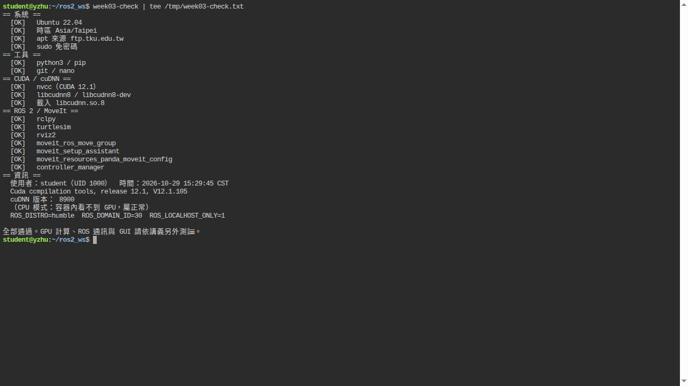
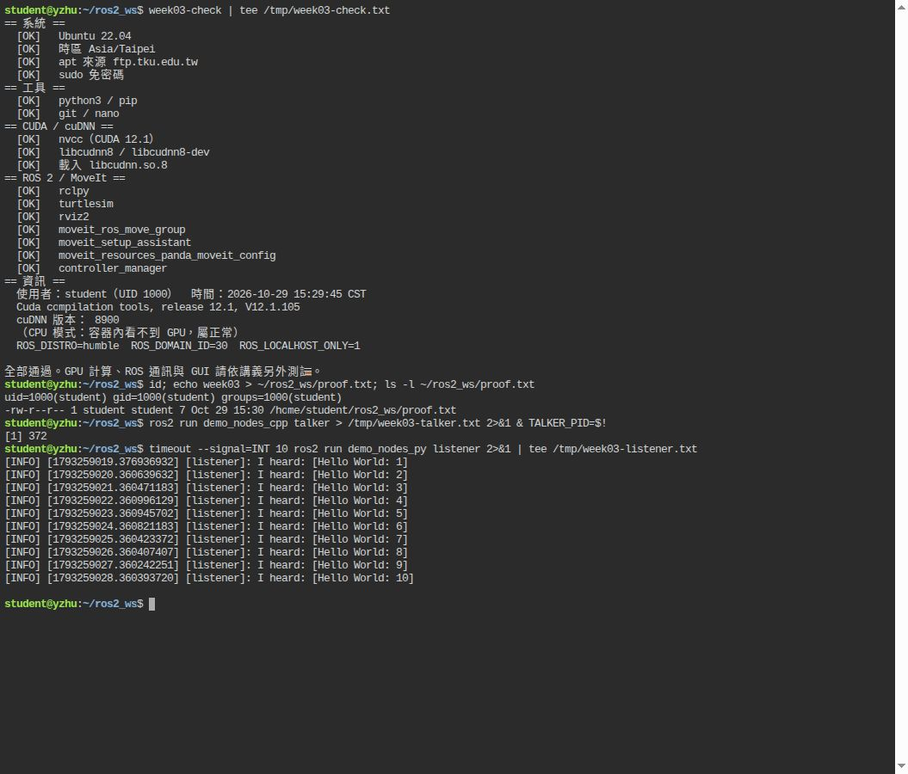
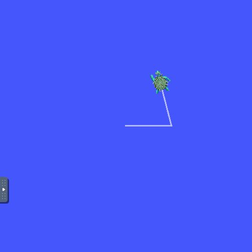
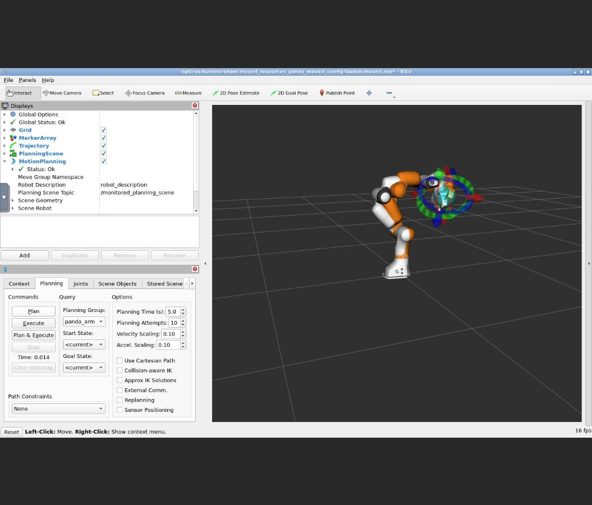
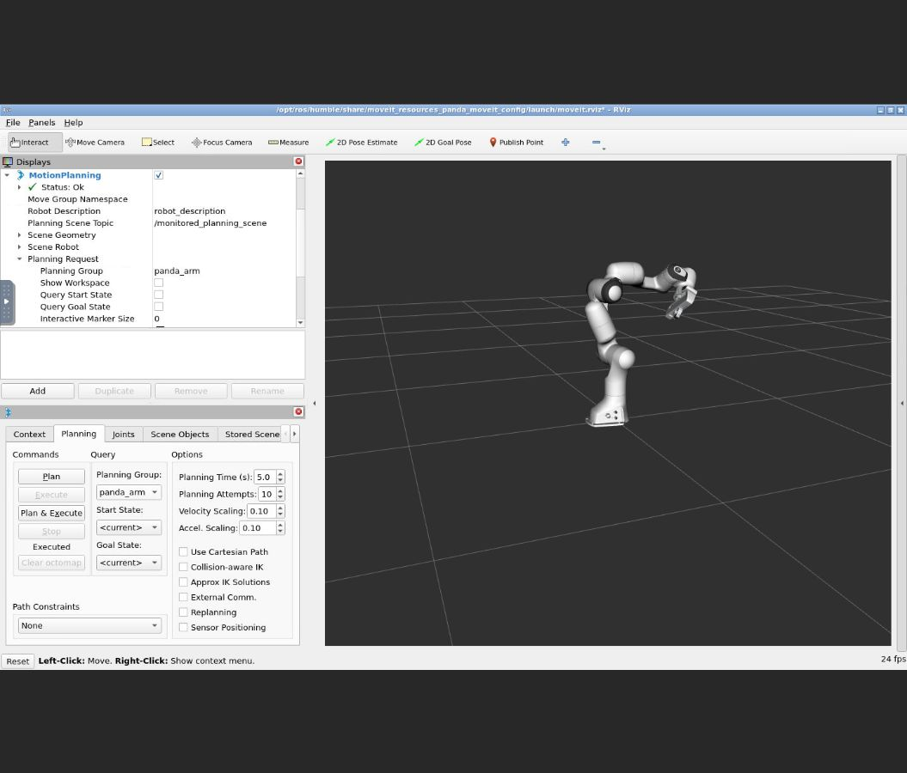
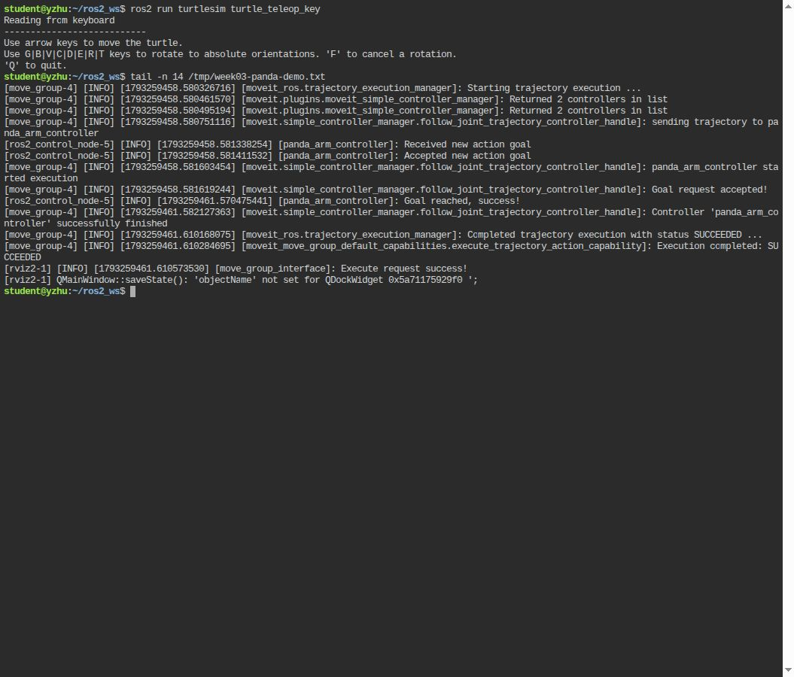

# 第三週實作紀錄（CPU 模式）

日期：2026-10-29（Asia/Taipei）。依課程提供的 `week03_lab_v3` 建置並實際執行。

## 驗收結果

| 項目 | 結果 |
| --- | --- |
| 階段 A：Ubuntu、時區、鏡像、CUDA、工具 | 通過；CUDA 12.1.105、Python 3.10.12、Git 2.34.1、nano 6.2 |
| 階段 B：ROS 2、MoveIt、student | 映像 `motor-control:week03` 建置完成；重建有 13 個 CACHED 步驟 |
| `week03-check` | 16 項 `[OK]`，全部通過；cuDNN 8.9.0 |
| ROS 通訊與工作區 | listener 連續收到 10 筆 Hello World；掛載檔案主機擁有者為 aa／UID 1000 |
| turtlesim | 實際方向鍵前進與轉向；位置從 (5.544445, 5.544445) 移到 (7.055423, 7.496164) |
| MoveIt Panda | RViz 拖曳目標、Plan、Execute 成功；控制器回報 SUCCEEDED，執行約 3.03 秒 |
| GPU Toolkit | 依使用者選擇先採 CPU；GPU runtime 與 GPU 計算尚未驗證 |
| GitHub | 公開 repository：[yunhui0423/week03_lab](https://github.com/yunhui0423/week03_lab) |

容器為 Ubuntu 22.04，使用者 `student`／UID 1000；`ROS_DISTRO=humble`、`ROS_DOMAIN_ID=30`、`ROS_LOCALHOST_ONLY=1`。CPU 繪圖為 llvmpipe。

## 作業截圖

### 環境驗收



### ROS 2 通訊



### turtlesim 鍵盤控制



### Panda 規劃與執行







## Panda 移動的實際關節角度

角度單位為 rad，取自 `/joint_states`，可確認模擬控制器已移動。

| 關節 | 執行前 | 執行後 |
| --- | ---: | ---: |
| panda_joint1 | 0.000000 | 0.167037 |
| panda_joint2 | -0.785000 | -0.458702 |
| panda_joint3 | 0.000000 | -0.033028 |
| panda_joint4 | -2.356000 | -2.099871 |
| panda_joint5 | 0.000000 | -0.569672 |
| panda_joint6 | 1.571000 | 1.002679 |
| panda_joint7 | 0.785000 | 0.775914 |

原始資料：`evidence/panda-before.yaml`、`evidence/panda-after.yaml`；完整啟動與成功紀錄：`evidence/panda-demo.txt`。

## 重新執行

在主機進入本資料夾後：

```bash
bash build.sh
GPU=0 ROS_LOCALHOST_ONLY=1 bash run.sh
```

容器內驗收與啟動 demo：

```bash
week03-check
ros2 launch moveit_resources_panda_moveit_config demo.launch.py
```

另一個主機終端進入同一個容器：

```bash
docker exec -it motor-week03 bash
```

本版官方 demo 的 RViz 初始設定未加入 MotionPlanning：在 Displays 按 Add → moveit_ros_visualization → MotionPlanning，Planning Group 選 `panda_arm`。勾選 Planning Request → Query Goal State 可拖曳末端，再按 Plan、Execute；取消 Query Goal State 可清楚觀看實際手臂。

也已提供 `week03.rviz`：主機先 `cp week03.rviz ros2_ws/week03.rviz`，再於 RViz 用 File → Open Config 開啟 `/home/student/ros2_ws/week03.rviz`。需拖曳目標時重新勾選 Query Goal State。

主機的 `verify_cpu.sh` 可在容器啟動後重跑基本驗收、掛載與 ROS 通訊測試；圖形操作截圖另外保存在 evidence。

## 環境說明

- NVIDIA 驅動留在主機；CUDA／cuDNN 在映像裡。主機偵測到 Driver 550.144.03、CUDA 相容上限 12.4。
- 本次依使用者選擇採 CPU 模式，未安裝主機 NVIDIA Container Toolkit。
- 用相同 UID／GID 建立 student，使掛載的工作區檔案保持主機帳號的擁有權。
- Dockerfile 將常用且較少變動的環境放前面；重建紀錄可看到 CACHED。
- 機器人為 mock 硬體，MoveIt 規劃後由 ros2_control 模擬執行。
- 本機驗收時使用隔離虛擬顯示器與瀏覽器終端，方便觀看操作；這些檢視工具不影響課程映像的 Dockerfile。
